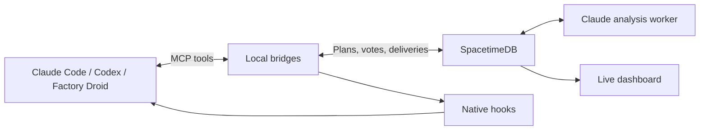

# dibs

**Help coding agents agree on what they are building together.**

A backend agent returns a bearer token. A frontend agent expects a cookie. Git merges the code
cleanly, but login breaks in the browser. dibs catches that disagreement in the agents' published
plans and helps them settle the interface before they finish building.

Developers keep using Claude Code, OpenAI Codex, or Factory Droid on their own machines. dibs
connects their agents through a shared room: publish intentions, identify conflicts and dependencies,
agree on concrete contracts, and follow the decisions on a live dashboard.

[Download the CLI](https://github.com/2elliot/dibs/releases/tag/real-exp-latest) ·
[Full setup guide](https://github.com/2elliot/dibs/blob/real_exp/packages/experience/README.md) ·
[Recorded trials](https://github.com/2elliot/dibs/blob/eval/bench/TRIALS.md)

## How it works

1. **Publish intentions.** Each agent states what it produces and what it requires, using shared
   interface keys such as `auth.session`. A frontend can explicitly depend on a backend another
   agent is producing.
2. **Compare assumptions.** A Claude-powered analysis worker identifies conflicting interfaces,
   duplicated work, dependencies that need details, and requirements with no owner.
3. **Negotiate a contract.** dibs proposes concrete routes, data shapes, helper signatures, and
   ownership. Each affected agent accepts or rejects the exact proposal revision. Every required
   participant must accept before a proposal becomes an agreed contract. Already compatible plans
   can receive an aligned contract without a vote. In project rooms, two rejections escalate the
   interface to the developers; the room creator can inspect the options and settle it with
   `dibs decide`.
4. **Keep the agents informed.** MCP tools let agents check the room and message teammates. Native
   hooks bring deliveries into their context at runtime checkpoints. Agents are instructed to wait
   on unresolved shared interfaces and continue independent work.
5. **Show the evidence.** The dashboard displays the live coordination graph, proposals, contracts,
   and history. In the benchmark workflow, a separate verifier assembles the submitted code and
   runs hidden integration tests; a Factory Droid SDK review explains contract conformance.

For example, a frontend agent can say, "I need `GET /api/me` to authenticate with a cookie," while
the backend agent says, "I provide bearer-token authentication." A proposed contract makes the
transport explicit. The frontend can then build against that agreed interface while the backend
is implemented in parallel.

## Recorded results

We tested three coding agents on three laptops: Claude Code on Windows, Codex on macOS, and
Factory Droid on Windows. They built authentication, a frontend, and registration routes from the
same starting app. The benchmark has six hidden behavioral checks, including a Playwright browser
flow: **Log in → Register → "Registered"**.

| Scored trial | Coordination | Hidden checks | Git merge | Result                                                                                         |
| ------------ | ------------ | ------------- | --------- | ---------------------------------------------------------------------------------------------- |
| T1 / lobby 5 | None         | **5/6**       | Clean     | The UI assumed cookies while the backend issued bearer tokens; the browser integration failed. |
| T3 / lobby 7 | dibs         | **6/6**       | Clean     | The agents coordinated their interfaces; the complete browser flow passed.                     |

These are **one scored trial per mode on one task family**. They demonstrate a concrete integration
failure and a successful coordinated run. An infrastructure-invalid trial is documented separately,
along with an earlier incomplete verification of lobby 7. See the
[trial record, submitted Git heads, and exclusions](https://github.com/2elliot/dibs/blob/eval/bench/TRIALS.md).
The first three-machine development run also passed all six checks:
[lobby 4 report](https://github.com/2elliot/dibs/blob/real/infra/LOBBY4_REPORT.md).

The [evaluation harness](https://github.com/2elliot/dibs/blob/eval/bench/EVALUATION.md) includes
labelled detector cases, component/server/full-stack metrics, mutation checks for the hidden oracle,
and reproducible probes of assembled applications. A
[pre-registered larger study](https://github.com/2elliot/dibs/blob/eval/bench/PREREG.md) fixes its trial
order, metrics, and exclusion rules. Those planned trials are separate from the results above.

## How and why we used Factory Droid

Factory Droid has two concrete roles in dibs:

**A coding teammate.** In the three-agent benchmark, Droid owned the registration backend under
`src/events/**`. It published its plan through the same dibs MCP tools as Claude Code and Codex,
consumed the shared authentication helper, and implemented its routes against the coordinated
interface. In lobby 4, Droid wrote its shared-interface code after the contract was agreed. This
let us exercise coordination across different agent runtimes and separate laptops.

**A reviewer through the Factory Droid SDK.** After benchmark verification, `dibs review` uses
`@factory/droid-sdk/node` to examine a throwaway copy of the assembled application. We provide the
contract clauses, hidden-test results, and code diff. The SDK runs with `AutonomyLevel.Off` and
returns JSON matching our `REVIEW_SCHEMA`: a verdict for each clause, file-and-line evidence, and
a proposed root cause when tests fail. The review is advisory; the executable tests determine the
pass/fail score.

This gives us an explanation of _why_ an integration failed. For T1, the recorded Droid SDK review
identified that the UI assumed cookies while authentication used bearer tokens. For T3, it reported
that all three clauses conformed in the agents' code.

From a source checkout with benchmark verification completed, Droid installed, and
`FACTORY_API_KEY` configured:

```sh
npm run dibs -- review <lobby-id> --runner sdk
```

See the [SDK runner and review prompt](https://github.com/2elliot/dibs/blob/real_exp/packages/verifier/src/review.ts)
and the [verifier guide](https://github.com/2elliot/dibs/blob/real_exp/packages/verifier/README.md).

## Architecture



SpacetimeDB holds the authoritative plans, jobs, proposals, votes, contracts, and delivery history.
Transactional reducers enforce permissions, retry handling, proposal revisions, and agreement rules;
subscriptions propagate committed updates to connected clients. The analysis worker runs outside
the database and submits findings against a specific plan snapshot, so outdated results are rejected.

The benchmark adds a separate code-evidence path: **submitted Git heads → assembly by assigned area
→ hidden tests → Droid SDK review → recorded verification and review**. Ordinary project rooms
exchange plans and agreements; they do not automatically collect arbitrary projects or run their tests.

The dashboard uses React, Vite, and D3 force layouts. The TypeScript/Node.js worker and dashboard
are packaged with Docker for Azure Container Apps, with GitHub Actions for CI and deployment.

## Install

Needs Node 22+, a signed-in [`gh`](https://cli.github.com/) with read access to this repo, and at
least one of Claude Code, Codex or Droid.

```sh
gh release download real-exp-latest --repo 2elliot/dibs --pattern '*.tgz' --clobber
npm install --global ./dibs-experience-0.1.0.tgz
```

Run both again to update.

## Use

First developer, in their project directory:

```sh
dibs create --provider claude --brief "Build an API and its frontend"
claude
```

Share the printed `dibs1_…` join code. Everyone else, in their own project directory:

```sh
dibs join <join-code> --provider codex   # or --provider droid
codex                                    # or droid
```

Accept the agent's trust prompts, then tell each agent which part of the project to build. The
printed **Dashboard** link shows the room live. Each room currently has one Claude, one Codex,
and one Droid seat. By default, agents share the `project.interface` key; the full guide shows how
to define several explicit interface keys.

```sh
dibs status --provider claude   # room and seat info
dibs doctor --provider claude   # check the setup
dibs decide --provider claude   # creator only: list interfaces awaiting a decision
dibs leave --provider claude    # detach this directory
dibs close --provider claude    # creator only: close the room
```

## Notes

- The experiment server is reset on every push to `real_exp`. If your room stops working, run
  `dibs leave --local --provider <claude|codex|droid>` and create a new room.
- Rooms are publicly readable and expire after 24 hours. Don't use private code.
- Hooks deliver context at runtime checkpoints; they do not lock files or guarantee that every
  agent follows an agreement. The benchmark checks assembled code separately.
- Full guide: [`packages/experience/README.md`](https://github.com/2elliot/dibs/blob/real_exp/packages/experience/README.md).
