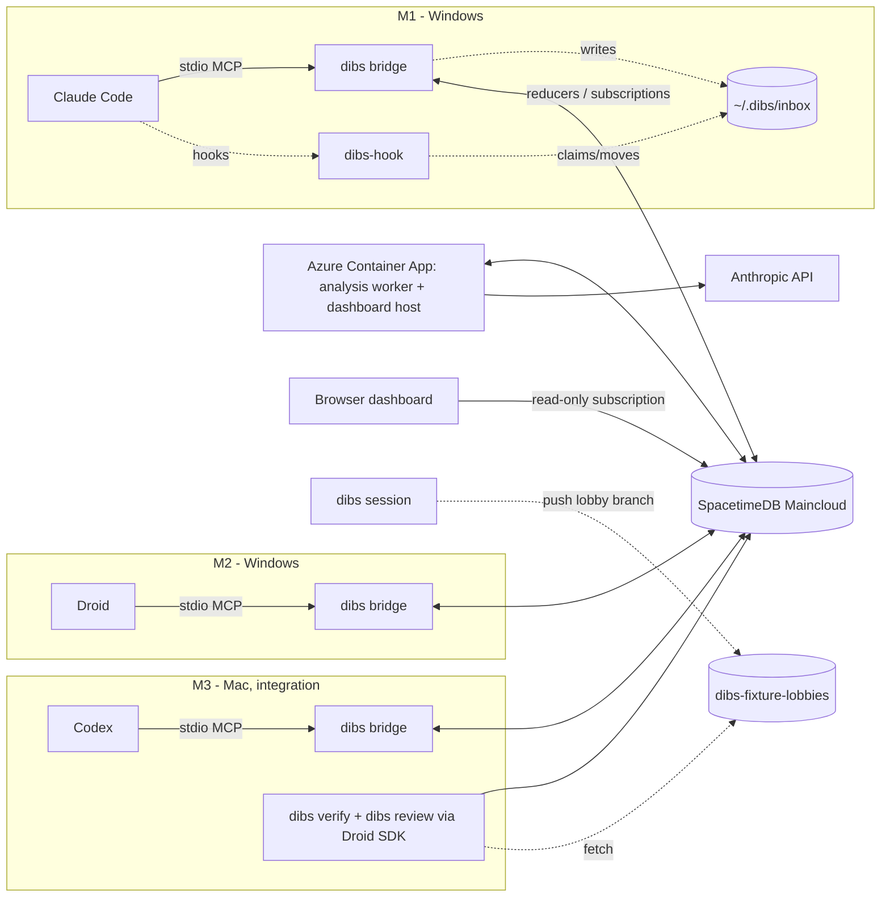

# dibs — team plan v2 (final)

**Status:** final execution plan; replaces v1. Finalized Sat Oct 24, ~02:00 PT, after two review rounds by five reviewers: schedule, SpacetimeDB/Azure, agent integration, demo/judging, red team. Nothing is built yet.

**Notation:** **[G0]** = prove it in Gate 0 before anyone builds on it. The config snippets in the appendices come from current docs, but still get the [G0] check against your installed versions.

**Hard deadline:** Devpost, **Sun Oct 25, 9:00 AM PDT**. Be at the venue by 8:00 AM Sunday. Winners are announced at 4:00 PM.

**Freezes:**
- **Freeze 1, Sat 18:25:** everything agents touch — module, bridge, hooks, worker, prompts, oracle.
- **Freeze 2, Sat 21:30:** everything. After that, only demo-blocking fixes.

**Team:** A = state & cloud (____) · B = agent integration (____) · C = product & evidence (____).

**Machines:**

| Machine | OS | Agent | Owner | Notes |
|---|---|---|---|---|
| M1 | Windows | Claude Code | ____ | Best native Windows support |
| M2 | Windows | Droid | ____ | Droid hooks on Windows are the least-verified piece; test them first |
| M3 | macOS | Codex | ____ | Also integration, verifier, oracle key, pilot |

The Mac runs Codex, whose Windows support lags, and handles integration. Playwright, the oracle, `git merge-tree` and the pilot are simplest on one POSIX machine. Each machine owner runs their own CLI; B owns the scripts.

## Prizes

Per the Devpost page, checked Sat 01:00.

| Sponsor | Listed prize | Our angle | Action |
|---|---|---|---|
| Factory | **Best Use of the Factory Droid SDK** ($2,000) | Every verification gets a read-only Droid SDK review. It returns structured JSON mapping each contract clause to file:line evidence and naming which side broke it. Droid CLI is also one of the three agents | The SDK review **is** the entry. The `droid exec` CLI fallback likely voids it, so ask Factory before falling back |
| Microsoft | **Built for the Real World** / Customer Impact Award (Azure not mentioned) | Real teams mix vendors and OSes: native Windows, three rival vendors' agents, one setup per laptop. It degrades safely, and a restarted worker re-leases the job. Hosted on Azure Container Apps | Ask the booth whether Azure matters |
| SpacetimeDB | None listed | SpacetimeDB is the whole backend and the only realtime transport | Ask the booth by 12:00 Sat; no extra hours until confirmed |
| Anthropic | None listed (12.0 had "Best Use of Claude") | Claude finds conflicts from cited plan statements and drafts the contract; Claude Code is one of the agents | Ask the booth by 12:00 Sat |
| Creao | Best Team Empowerment ($3,000), rules not read | Teams of humans + agents | Read the rules; select it if eligible |

**Judging:**
- Criteria: Application, Intentionality, Functionality, Creativity, Technical Complexity.
- Format: 3-minute pitch + 2 minutes of Q&A.
- Sponsors judge asynchronously from the **Devpost video**.
- **Required:** a project image and a GitHub repo link.

Log booth answers in `docs/booth-answers.md`.

## What changed from v1

- **No Relay.** SpacetimeDB is the source of truth and the realtime transport: reducers in, subscriptions out.
- **The bridge is the MCP server each CLI already spawns.** Hooks read a local inbox folder.
- **Four agent tools, down from seven.** `dibs_status` long-polls and tells agents when to stop waiting.
- **Agents never commit.** `dibs session` commits and pushes at a scheduled stop, the same in every mode. Verification assembles each agent's own folder; out-of-area edits are counted, not merged.
- **The Droid SDK does a clause-by-clause contract review.** It's advisory; pass/fail comes only from test exit codes.
- **The fixture has three coordination points.** An unscored pilot at 09:30 validates it.
- **Two dry runs before Freeze 1**, then up to 7 trials in priority order (expect 6).
- **Clock-time schedule:** two sleep blocks, a v1 submission before the second sleep, and venue logistics.
- **Native Windows:** everything is Node (no bash), hooks use exec form, line endings are LF.

## 1. Schedule (Pacific)

### Gate 0 (Sat 01:15–04:00)

| Owner | Work, with checkpoints |
|---|---|
| A | Push the monorepo skeleton (npm workspaces) first. **By 02:15:** `participant`, `invite`, `message`, `delivery`, `event` (+ `admin` via `init`), published to `dibs-ch13-dev`, with bindings committed. Then: Node client with stored token; `spacetime call` bootstrap check (§4); drop-Wi-Fi-for-20-s reconnect test. **03:15:** hello-world Azure deploy (§8) to catch the ACR cloud-build block early. |
| B | Prove the hooks **without the DB first**: `dibs-hook.mjs` reads a hand-written inbox file. Claude Code on M1 (Windows) by **02:00**. Machine owners run B's script for Droid on M2 (Windows) by **02:45** and Codex on M3 (Mac) by **03:00**. From 02:15: bridge v0 on A's bindings (`dibs_message`, `dibs_status`, inbox writer). |
| C | Fixture repo + charter + **S1/S2/N role prompts + mode text** (the 09:30 pilot needs them) + oracle + three reference solutions. The oracle must **pass the cookie reference, pass the bearer reference, and fail the mismatched reference** by **03:30**. Encrypt oracle + references into `bench/oracle.enc` (key only on M3). Dashboard skeleton (lists `event` rows) once bindings land. |
| Machine owners | Install and log in to all three CLIs on M3 (for the pilot). Install Chromium for Playwright on M3. Do a non-interactive `git push` to `dibs-fixture-lobbies` from every machine, including Windows. Accept each CLI's one-time trust prompts for the fixed clone path (§5.5). |
| All, 03:30–03:50 | Gate 0 exit test. **03:50:** each owner writes status + next step in `docs/compatibility.md`. |

**Gate 0 exit:**

- **(a) Hooks, all providers.** A hand-written inbox file ("use port 4001 for any server") changes the next action of all three agents, each on its own OS.
- **(b) Live delivery.** A real message from M3 (Mac) goes through Maincloud to M1's bridge and changes Claude Code's next command. Windows is the receiver here.
- **(c) Oracle.** It behaves correctly on all three references.
- **(d) Azure.** The hello container is reachable, or the failure is logged with the fallback chosen.

**If Gate 0 isn't done by 04:00, sleep anyway.** At 08:30 only the owners with unfinished items resume them.

### Saturday

| When | A — state & cloud | B — agent integration | C — product & evidence | Checkpoint / exit |
|---|---|---|---|---|
| 04:00–08:30 | **Sleep** | | | Alarms set |
| 08:30–09:00 | Breakfast + standup: **freeze "API v1"** (reducer signatures + the columns B and C read). **08:45:** confirm the Anthropic model ID + structured-output call | | **09:00:** create the Devpost project; everyone joins; read the prize rules | API v1 in `packages/bindings/API.md` |
| 09:00–11:30 | Stub reducers + bindings for API v1 by **09:45** (incl. admin `debug_deliver`). Then real reducers, schedule tables (§4), worker running locally, `dibs lobby` / `dibs join` CLI | Bridge: 4 tools, `waitSec` long-poll, `fallbackInSec`, mode from `session.json`, reconnect, stderr-only logs, pid lockfile | **09:00: launch the unscored S2 pilot on M3** — three clones, None-mode prompts with the `dibs_plan` sentence removed, since the bridge isn't ready. During its agent window, do the Droid SDK check (§7). **09:45:** run the oracle on the pilot and fix the charter. **10:00:** hand A `plans-s2-dev.json` + `plans-neg-dev.json`. **10:15–12:30:** `dibs verify`, built against the reference branches | **11:30:** hand-fed dev plans produce a proposal row with citations. Sync to main at 11:30 |
| 11:30–13:30 | Validation; supersede and one-open-proposal rules; job re-queue on rejection | Hook JSON outputs, Stop guard, `systemMessage`, minimal `dibs session prep` | `dibs verify` continues; dashboard header, timeline, contracts panel. **11:45:** ask the sponsor booths | Sync at 13:00. **13:30 exit, judged on DB rows, not UI** (`spacetime call` and a hand-written `session.json` are OK): dibs mode, S2 prompts, M1 + M3 (Claude Code + Codex). Plans → cited proposal → both respond → contract agreed → the consumer's next edit follows it |
| 13:30–14:00 | **Lunch** | | | |
| 14:00–16:00 | Azure deploy of worker + dashboard **pointed at the dev DB** (§8); worker heartbeat. Tune analysis on dev plans + 13:30 traces. Write the 16:00 cutover script | Full `dibs session` (prep/start/stop, hook-alive, build check); Droid as third agent; Windows hardening on M1 + M2 (**max 60 min**) | Handoff panel, scorecard; `dibs verify` polish (area assembly, out-of-area count, merge-tree info) | Sync at 15:45 |
| **16:00** | **Cutover** (§8 checklist): publish `dibs-ch13-demo`; claim invites on it from every machine and the worker; flip Azure to the demo DB; deploy `bench-rc1`; everyone installs rc1. **No schema changes after this.** Logic-only republishes are allowed until 18:25 | | | rc1 on every machine and on Azure |
| 16:30–17:00 | **Dry run #1** (S2-dibs, unscored) on exactly rc1, all three machines | | | Stage times recorded |
| 17:00–17:40 | Fix dry-run bugs. **17:30 (A):** check usage/quota headroom on all agent accounts and the Anthropic key; have a spare ready | | | |
| 17:40 | Deploy **rc2** everywhere (Azure + all machines) | | | |
| 17:45–18:10 | **Dry run #2** on rc2. Eat during the agent window | | | Zero keystrokes needed |
| 18:10–18:25 | Blocker fixes only. If anything changed, redeploy before 18:30 | | | |
| **18:25** | **Freeze 1:** tag the deployed build `bench-v1`; `create_lobby` records its hash; prompts + oracle hashed. No deploys until trials end | | | |
| 18:30–21:00 | Operator (create/start lobbies); Devpost text; invariant tests (§4) | Machine checks between trials; offline replay (from dry-run exports); scorecard/handoff polish (dashboard only) | `dibs verify` of trial N runs during trial N+1; build `dibs review` (Droid SDK) against dry-run trees | **S2-dibs and S2-None done by 19:45. No trial starts after 21:00** |
| 21:00–21:30 | **21:20:** redeploy the dashboard with the final replay exports | Export all replays (JSON) | Batch `dibs review` on every recorded verification | |
| **21:30** | **Freeze 2.** Choose the live/replay split from measured stage times (P50 launch → proposal); write the script variants (§12) | | | |
| 22:00–22:45 | **Rehearsals ×3**, screen-recorded (this is the video footage). Clean = zero keystrokes and ≤ 3:00 | | | |
| 22:45–00:00 | Devpost text + README; `docs/demo-release.md` | gitleaks scan; make `dibs`, `dibs-fixture`, `dibs-fixture-lobbies` and the plaintext oracle public (hash = `oracleHash`) | Edit the video (≤ 3:00, captions naming each sponsor's tech as it acts) | |
| **00:00–00:30** | **Submit a complete v1 to Devpost:** image, repo links, video, prize selections | | | If anyone oversleeps, only polish is lost |

### Sunday

**Travel:** BART's Sunday service starts around 8 AM, so it can't get you there by 08:00. **Sleep at the venue** (calhacks.io mentions a sleeping area; confirm it) or **pre-book a car for 06:30**.

| When | What |
|---|---|
| 00:30–05:00 | **Sleep** |
| 05:00–06:15 | Smoke-test the demo DB, Azure and all three machines. Final Devpost edits. Last code change 06:00 if traveling, otherwise 07:00 |
| 06:30–07:30 | Travel if you slept elsewhere |
| 08:00–08:30 | At the venue: power strip, phone hotspot, 20 pt terminal fonts, dashboard on the biggest screen. **One fresh lobby on venue Wi-Fi.** Check the Devpost submission |
| 09:00 | Hard deadline. **Judging rota:** A presents and resets M2 between judges; B operates M1 and covers M3 while C is at booths; C operates M3 and visits sponsor booths between judges |

### Decision rules

- The absolute deadline beats the table. If a phase slips more than 1 h, cut from §13 before cutting sleep.
- If two-machine delivery isn't working by 10:00 Sat, A pairs with B; C continues. The oracle is never cut.
- If the third provider's hooks are still blocked at 16:00, ship it tool-only (§5.5) and say so.
- Only A publishes the module and regenerates bindings, in the same commit as any schema change. **No schema changes after 16:00.**

## 2. Product and acceptance

> **Git merged it cleanly. The app still broke.** For small teams where everyone runs a different coding agent — like us. Three developers, three vendors' agents, three laptops. dibs catches the conflicts git can't see — in the agents' assumptions — gets the affected agents to a **handshake** on one contract, and proves with a hidden test that the combined code works.

**MVP acceptance.** Each item needs evidence (DB rows, commits, test output), not a claim:

- [ ] Claude Code, Codex and Droid run on three machines (two native Windows, one Mac) in one lobby.
- [ ] Each publishes a structured plan, and dibs finds a real conflict or dependency in those plans.
- [ ] A proposal cites the source plan statements. Every required party responds, and the contract is agreed ("HANDSHAKE n/n").
- [ ] At least one agent's later action visibly follows the contract (a tool call or diff).
- [ ] The verifier assembles the three areas from the recorded branch heads. The hidden oracle gives pass/fail on that exact tree, and the Droid SDK review is attached.
- [ ] The Azure-hosted dashboard shows plans, proposal, responses, contract, heads, test result and review.
- [ ] At least S2 in modes None and dibs (§11) is complete.

**Rules that never change:**

- Agents stay autonomous.
- The model proposes; the parties whose plans would change accept.
- A completion report never counts as verified.
- Replays and recordings are labeled.
- A trial is never rerun to change its result. A tooling crash is recorded, and any rerun is labeled.

## 3. Architecture

**Lobby:** the shared workspace a set of agents is put into. Each trial or demo gets a fresh lobby. Agents in the same lobby share a mode, a key vocabulary and a timer, and see each other's plans, messages and proposals. Agents join with `join_lobby`; their work is pushed as `lobby/<id>/<provider>` branches.



| Component | Does | Never does |
|---|---|---|
| SpacetimeDB module | Holds all state. Reducers enforce the rules; scheduled reducers do debounce and lobby timers; subscriptions push changes | Call external APIs |
| Bridge (one per agent session) | MCP tools; DB connection with its own token; writes inbox files; marks deliveries | Decide ownership; accept anything for its agent |
| `dibs-hook` | Prints unseen inbox items into agent context at checkpoints | Make network calls; break the agent on its own errors |
| `dibs session` | Preps the clone, launches the CLI when the lobby starts, kills it at the stop, commits + pushes | Run during development sessions |
| Worker (Azure) | Leases analysis jobs, calls Claude, submits findings; serves the dashboard, `/config.json` and health | Vote for a party; write outside its reducers |
| Verifier (M3) | Assembles areas, runs the encrypted oracle, records evidence, runs the Droid SDK review | Let the review change pass/fail |
| Dashboard | Read-only live view; offline replay from exported JSON | Call reducers |

**Identity:** every process has its own token file, `~/.dibs/tokens/<participant>.token`. M3 holds `codex` and `verifier`. The worker's token is an Azure secret. Reducers authorize by `ctx.sender` → `participant.role`. Nothing trusts an ID inside a payload.

## 4. State (owner A)

**Databases:** a SpacetimeDB **2.x** TypeScript module on Maincloud.

- `dibs-ch13-dev` is for development.
- `dibs-ch13-demo` is for the demo and benchmark. It's published at 16:00; after that, no schema changes, and logic-only republishes only until 18:25.
- Names must match `^[a-z0-9]+(-[a-z0-9]+)*$`, are first-come, and only the owner can republish, so A does every publish.

**Visibility:** all tables are public except `admin`, `invite` and the timers. Data is synthetic. Public visibility is not access control: every write goes through a reducer.

**Conventions:**

- **Ids** are `t.u32()` autoinc. **Times** are `…Us: t.u64()` micros. Convert every u64 to `Number` before any JSON; `JSON.stringify` throws on bigint.
- **No composite keys.** Use synthetic unique strings (`slot`). Upsert = `slot.find()` then `id.update({...row})`. Always `find` before `insert`: a duplicate insert throws and aborts the whole reducer.
- **[G0]** Whether a primary-key update may change a unique column. If not, delete + insert.
- **Reducers return nothing.** Clients `await` the call (`Promise<void>`, which rejects with `SenderError`), then read the result from their subscribed rows, keyed by `requestId`.
- **Subscriptions** use the typed query builder (e.g. `tables.delivery.where(r => r.targetId.eq(me))`): one table per query, joins only on two indexed columns. 2.0 snake_cases SQL names. Subscribe to `participant` whole; it's tiny, and filtering on an optional column is unverified.
- **Schedule tables** must exist before 16:00, because a table's scheduling status can't change later.
- **Idempotency:** store canonical payload JSON (≤ 4 KB) in `request` and compare strings. No crypto in the module.

**Tables:**

| Table | Key fields |
|---|---|
| `admin` (private) | identity |
| `invite` (private) | code (plain), name, provider, role (`agent`/`worker`/`verifier`/`admin`), used |
| `participant` | id, identity (unique), name (unique), provider, role, online, buildHash, currentLobbyId? |
| `lobby` | id, scenario, mode (`none`/`chat`/`dibs`), baseSha, vocabulary, buildHash, state (`setup`/`running`/`stopped`/`verified`), startedAtUs, fallbackAtUs, endsAtUs |
| `plan` | id, lobbyId, participantId, revision, goal, notes, requestId, createdAtUs |
| `plan_item` | id, planId, lobbyId, participantId, kind (`produces`/`requires`), key, text |
| `message` | id, lobbyId, fromId, to, text, createdAtUs |
| `job` | id, slot (unique = `lobbyId`), lobbyId, kind (`analyze`/`revise`), state (`debouncing`/`queued`/`leased`/`done`/`failed`), inputKey, leaseToken, leaseExpiresUs, attempts, error |
| `job_timer` (scheduled, private) | scheduledId, scheduledAt, jobId, inputKey |
| `lobby_timer` (scheduled, private) | scheduledId, scheduledAt, lobbyId, action (`analyze_anyway`/`fallback`/`stop`) |
| `proposal` | id, slot (unique: `lobbyId/key` while open, `closed/<id>` after), lobbyId, key, revision, relation, contractText, rationale, citedItemIds, requiredPartyIds (frozen at creation), state (`proposed`/`accepted`/`rejected`/`superseded`/`escalated`), inputKey |
| `response` | id, lobbyId, proposalId, revision, participantId, decision, reason |
| `contract` | id, lobbyId, key, revision, text, source (`agreed`/`aligned`), proposalId? |
| `delivery` | id, lobbyId, targetId, kind, refId, summary, stage (`queued`/`received`/`shown`/`responded`), stage times (Us) |
| `event` | id, lobbyId, atUs, actor, type, subjectId, detail (small JSON; **never** codes, tokens or prompts). Append-only; drives timeline + replay |
| `head` | id, lobbyId, participantId, sha, outOfAreaFiles |
| `verification` | id, lobbyId, assembledFrom (JSON), treeHash, mergeTreeClean, oracleHash, exitCode, passed, total, reportHash, verifierId |
| `review` | id, lobbyId, verificationId, kind (`conformance`/`diagnosis`), summary, findings (JSON), model, sessionId |
| `request` | requestId (pk), payload, atUs |
| `service` | name (pk), lastBeatUs, detail (worker heartbeat, shown on the dashboard) |

**Reducers** (each appends an `event` row):

- **Bootstrap:**
  - `init` records the owner (the CLI-login identity) as admin.
  - A creates invites as the owner: `spacetime call -s maincloud <db> create_invite …`. Confirm reducer names with `spacetime describe -s maincloud <db> reducers`.
  - `spacetime call` is marked unstable, so [G0] test it. **Fallback:** `init` also inserts an `admin` invite with a `ctx.random` code, which A reads with `spacetime sql -s maincloud <db> "SELECT * FROM invite"` (the owner can read private tables), then creates the rest through `dibs admin`.
  - `claim_invite(code)` binds `ctx.sender`, failing if the name is already bound to another identity.
  - `client_connected`/`client_disconnected` update presence and **never throw**: dashboards and unclaimed clients connect too.
- **Admin:**
  - `create_lobby(scenario, mode, baseSha, vocabulary, buildHash)`
  - `start_lobby` sets `startedAtUs`, `fallbackAtUs = +6 min` (tune from dry runs) and `endsAtUs = +15 min`, and inserts `lobby_timer` rows for `analyze_anyway` (+2 min), `fallback` and `stop`.
  - `debug_deliver` (dev DB only).
- **Agent bridges:**
  - `join_lobby(buildHash)` rejects any build other than `lobby.buildHash`.
  - `publish_plan(requestId, goal, produces[], requires[], notes)` validates keys (vocabulary), counts (≤ 6 items) and lengths (≤ 500 chars). It writes a new revision. In `dibs` mode it upserts the lobby's job as `debouncing` with the new `inputKey` and inserts a `job_timer` at +5 s.
  - `send_message` (`chat`/`dibs` only)
  - `respond(proposalId, revision, decision, reason)`
  - `mark_delivery(id, stage)`: target only, forward-only.
- **`dibs session`:** `report_head(lobbyId, sha, outOfAreaFiles)`.
- **Scheduled:**
  - `promote_job` moves `debouncing → queued` only if `inputKey` is unchanged **and** every lobby participant has a plan, or `analyze_anyway` already fired.
  - `lobby_tick` handles `analyze_anyway`/`fallback`/`stop`.
- **Worker:**
  - `lease_job(jobId, leaseToken)`: the worker makes the token with `randomUUID()`; 60 s lease; an expired lease can be re-leased.
  - `submit_analysis(jobId, leaseToken, inputKey, findingsJson)`, `fail_job`, `heartbeat`.
- **Verifier:** `record_verification`, `record_review`.

**Rules — one test each, against a local `spacetime start`; written during the benchmark window:**

1. Callers act only as their own participant, inside their current lobby.
2. `submit_analysis` is rejected if the lease token or expiry is stale, or if `inputKey` no longer matches the current plan revisions.
3. Required parties = producers + consumers of the key, computed by the reducer and **frozen when the proposal is created**. The model's suggested list is ignored.
4. **One open proposal per key.** It's accepted only when every required party accepts that same revision. On the first rejection, the lobby's **same job row** is re-queued (`kind: revise`, `attempts: 0`, new `inputKey`); its unique slot means you never insert a second one. A second rejection → `escalated`.
5. **Only open proposals can be superseded,** and only when the text of a cited `(participant, key)` item changes. Re-publishing identical text (new ids, same words) changes nothing. An agreed contract stays in force; if someone later changes that key's text, a new proposal opens, and the old contract holds until the new one is agreed.
6. Same `requestId` + same payload → no-op. Same `requestId` + different payload → error.
7. Modes `none`/`chat` never create jobs or proposals. `none` rejects messages. Only the verifier role writes `verification`/`review`. "Unowned requirement" notices go out only after `promote_job` runs.

**`aligned`** means the plans already match, so nobody's plan changes and no vote is needed. It's informational, not a binding contract.

**Deliberately not built:** resource leases, heartbeat epochs, cycle detection, multi-workspace isolation.

## 5. Agent integration (owner B)

### 5.1 Files on each machine

```text
~/.dibs/
  config.json                 # dbUri, dbName (rewritten by `dibs join --db <name>`, e.g. at the 16:00 cutover)
  tokens/<participant>.token  # SpacetimeDB tokens — never in a repo
  session.json                # per lobby: lobbyId, mode, provider, clonePath, fallbackAtUs (written by `dibs session prep`)
  inbox/<seq>-<deliveryId>.json
  claimed/<deliveryId>.json   # hook claims by atomic rename, then touches mtime
  shown/<deliveryId>.json     # moved here after a successful print
  stopblocks.json             # Stop-block counter for this session
  bridge.lock                 # pid; taken over if that pid is dead
  hook-alive.json             # {lobbyId, sessionId}, written by the SessionStart hook
  claude.settings.json, claude.mcp.json, droid.settings.json   # byte-identical every lobby
```

Per-lobby data lives only in `session.json`, so provider configs stay byte-identical. That keeps Codex hook trust and Droid MCP approvals valid across trials.

### 5.2 Bridge

- **Startup.** It's spawned by the CLI as a stdio MCP server. It **answers `initialize` immediately**, reading the mode from `session.json`, then connects to the DB in the background. Codex's MCP startup timeout defaults to 10 s.
- **Logging and lifecycle.** All logging goes to **stderr**, since any stray stdout corrupts MCP. Catch every error. Never exit while stdin is open; exit when stdin closes.
- **Client.** `.withUri('https://maincloud.spacetimedb.com').withDatabaseName(db).withToken(tok)`.
  - Try `.withAutomaticReconnect()`; whether Maincloud supports it is [G0]. If it works, don't re-subscribe in `onAutomaticReconnect`, because subscriptions survive.
  - Fallback: on disconnect, rebuild the connection with backoff and re-subscribe.
  - A failed *initial* connect is never retried by the SDK, so retry it ourselves.
- **Subscriptions** (typed builder, filtered by lobby): `delivery` (target = me), `lobby`, `plan`, `plan_item`, `proposal`, `response`, `contract`, `message`, `job`. `participant` is subscribed whole.
- **Deliveries.** On a new delivery: write the inbox file (temp + rename), then `mark_delivery(id, "received")`. Every 1 s: mark files in `shown/` as `shown`, and return `claimed/` files whose mtime is more than 60 s old to `inbox/` (that means the hook crashed).
- **Reducer calls.** `await` with a 5 s timeout. `DisconnectedError` → `{status:"offline"}`. Timeout or `UnknownCallResultError` → `{status:"pending", requestId}`. Retrying with the same `requestId` is safe. Read the committed result from the cache by `requestId`.
- **Tools.** Registers only the tools for the lobby's mode.

### 5.3 Tools (4)

Annotate every tool with `destructiveHint: false`, and `dibs_status` also with `readOnlyHint: true`. Codex asks before tools that look destructive.

| Tool | Input → output | Modes |
|---|---|---|
| `dibs_plan` | `goal`, `produces[{key, statement}]`, `requires[{key, assumption}]`, `notes?` → new revision. Tool description: *"For each key, state concrete details: routes, request/response JSON, header or cookie names, status codes, exported function names, signatures and file."* | all (`none`/`chat`: logged only, never shown to peers) |
| `dibs_status` | `waitSec?` (≤ 45; returns early on any change) → `phase`, per-key `{key, status, contractText?, proposalId?}`, `awaitingYou[]` (full proposal text), unread `messages[]`, `fallbackInSec`, `roster`. Phase and statuses below | `chat`, `dibs` |
| `dibs_respond` | `proposalId`, `revision`, `decision: accept \| reject`, `reason` | `dibs` |
| `dibs_message` | `to: claude \| codex \| droid \| all`, `text` (≤ 1,000 chars) | `chat`, `dibs` |

**Phases:** `waiting_for_peers` → `analyzing` → `ready`.

**Key statuses:**
- While the phase is `waiting_for_peers` or `analyzing`, **every key you touch reports `pending`**.
- `clear` appears only when the phase is `ready` and no finding involves the key.
- The other statuses are `proposed`, `agreed`, `aligned` and `escalated`.

`fallbackInSec` counts down to the lobby's `fallbackAtUs`, the same absolute time for everyone. Agents can't keep time; the tool does.

### 5.4 Hooks

There is one zero-dependency script, `dibs-hook.mjs`, in exec form: `node <abs>/dibs-hook.mjs --provider <p>`. It reads the event name from stdin (`hook_event_name`).

- **Guard.** If stdin's `cwd` isn't inside `session.json.clonePath`, exit 0 silently. Compare `path.resolve` results, lowercased on Windows, because Claude passes `C:\…`. This keeps development sessions and the SDK reviewer unaffected.
- **Claim, then print.**
  - Rename each `inbox/` file into `claimed/`, skipping any whose rename fails (another hook won). On Windows, retry `EPERM`/`EBUSY` for 200 ms.
  - Immediately `utimes` the file: a rename keeps the old mtime, and the bridge's sweep would otherwise return it mid-print.
  - Print, then move it to `shown/`.
  - Provider hook timeout 10 s; no self-abort.
- **Output.** SessionStart, UserPromptSubmit, PostToolUse (and Claude's PostToolUseFailure) print **only** JSON: `{"hookSpecificOutput":{"hookEventName":"<E>","additionalContext":"<text>"},"systemMessage":"dibs: <one line>"}`.
  - `systemMessage` is a visible line for the human, documented for Claude and Codex. **Leave it out for Droid** unless Gate 0 shows Droid accepts it.
  - Plain stdout is dropped at PostToolUse on all three.
- **Stop prints only** `{"decision":"block","reason":"<text>"}` or nothing — never the offline notice.
  - **Block when:** a proposal awaits this agent (at most once per proposal id), or its keys are `pending` and `fallbackInSec > 0`.
  - **Cap:** at most 8 blocks per session, counted in `stopblocks.json`. Rely on the counter, **not** `stop_hook_active`.
- **SessionStart** also writes `hook-alive.json` with the `lobbyId` and the provider's `session_id`.
- **Context text.** At most 1,500 chars, proposals awaiting you first, written as **facts, not commands**: imperative, system-style text can trip prompt-injection defenses. Example: `dibs update from your team's coordination service: proposal P7 (rev 1) for auth.session awaits your response. Proposed contract: … Basis: claude's plan says "…"; codex's plan says "…".`
- **Offline.** If `bridge.lock`'s pid is dead or the config is missing, inject once, at a non-Stop event: `dibs coordination is offline; dibs_status may be stale.`

### 5.5 Provider setup (configs in Appendix A)

| | Claude Code (M1, Windows) | Codex (M3, Mac) | Droid (M2, Windows) |
|---|---|---|---|
| Where config lives | Launch flags only: `--settings`, `--mcp-config … --strict-mcp-config` | `<clone>/.codex/config.toml` + `<clone>/.codex/hooks.json` (gitignored); project trusted in `~/.codex/config.toml` | `<clone>/.factory/mcp.json` + `<clone>/.factory/hooks.json` (gitignored); `--settings ~/.dibs/droid.settings.json` |
| One-time trust in Gate 0 | Accept the folder trust dialog for the clone path | Trust the hooks, which are hash-pinned. New or changed hooks are **skipped**, with only a startup warning. Last resort: `--dangerously-bypass-hook-trust` [G0] | Approve dibs tools "always" (approval fingerprint = command + args) |
| No-prompt profile | `--permission-mode acceptEdits` + allow/deny rules, with PowerShell rules in **cmdlet names** | `--sandbox workspace-write --ask-for-approval never -c 'sandbox_workspace_write.network_access=true'` [G0: Codex must reach its own localhost server; an open macOS bug may ignore the setting]; MCP `default_tools_approval_mode = "approve"` | autonomy `medium` + permission rules [G0: `droid rules check --json`] |
| OS notes | Exec-form hooks (no shell, no quoting). Spawn `claude.exe` directly (Node throws `EINVAL` on `.cmd` without a shell). Stop = `taskkill /T /F` | Hook command runs in a shell: quote `<B>` if it can contain spaces | **[G0] first:** which shell runs Droid hooks and commands on Windows. Quote `<B>`. Permission-rule prefixes may need PowerShell forms. Spawn the `droid` executable directly, no shell. Stop = `taskkill /T /F` |

**Clone path:** fixed per machine, `~/dibs-clones/<provider>/fixture`, and reset in place each trial so trust survives. Every launch is a fresh session (never resume or continue). **[G0]:** check whether any CLI keeps per-project memory and disable it for the clone path. Never copy one provider's config into another.

**`/dibs` slash command.** The product is invoked as `/dibs` in all three CLIs. It's a custom command file that `dibs session prep` writes:

- Claude Code: `<clone>/.claude/commands/dibs.md`
- Droid: `<clone>/.factory/commands/dibs.md`
- Codex: `~/.codex/prompts/dibs.md` — custom prompts are user-level; [G0] whether it shows as `/dibs` or `/prompts:dibs`

The same text goes in every file: *"Call `dibs_status` with `waitSec: 0` and summarize for the human in at most 6 lines: lobby and mode, each shared key's status, proposals awaiting you, agreed contracts, and `fallbackInSec`. Don't edit code."*

It's for humans in development and demos, like showing the lobby live at the judging table. Typing it during a scored trial counts as an intervention.

**Tool-only fallback** (a provider's hooks fail Gate 0 or the hook-alive check): add to that agent's mode text: *"Call dibs_status at start, before touching a shared key, and before finishing."* Record it in `docs/compatibility.md` and the README. Cap: 1 extra hour.

### 5.6 `dibs session` (one per machine per trial)

1. **`prep <lobbyId>`:**
   - `git reset --hard <base> && git clean -ffdx -e .claude/ -e .codex/ -e .factory/ -e node_modules/`
   - Delete local lobby branches and `hook-alive.json`; reset `stopblocks.json`.
   - Rewrite the provider configs byte-identically; write `session.json`.
   - Check the local build hash against `lobby.buildHash`.
2. **`start`:**
   - Wait (subscribed) until the lobby is `running`, then launch the CLI with the frozen prompt. Use an argument array and no shell, so start skew is just DB latency.
   - Abort and flag if `hook-alive.json` with this `lobbyId` doesn't appear within 30 s.
3. **At `endsAtUs`** (scheduled `stop`):
   - Kill the CLI process tree.
   - `git add -A && git commit --allow-empty -m "lobby <id> <provider> final"`.
   - `git push <lobbies-url> HEAD:refs/heads/lobby/<id>/<provider>`, using the URL directly so the clone never has a remote that can see other lobbies.
   - `report_head` with the SHA and the files changed outside the agent's area.

Agents never commit or push; their rules deny it. Mode doesn't affect what gets collected.

## 6. Analysis (owner A)

1. The worker subscribes to `job` and leases a `queued` job on sight. Every 15 s it also rescans for `leased` jobs whose `leaseExpiresUs` has passed: an expired lease changes no row, so without the rescan a crashed worker's job would never retry.
2. It loads the **charter**, the vocabulary, and every current plan item (with ids and authors) in the lobby.
3. It calls Claude (model ID confirmed at 08:45 [G0]) with **structured JSON output** and streaming.
   - ~4,000 max output tokens, 90 s timeout.
   - One retry, only if ≥ 90 s remain before `fallbackAtUs`.
   - One call in flight per lobby, 30 calls per lobby.
   - Timing check: `analyze_anyway` at +2 min plus 90 s plus one retry still lands before the +6 min fallback.
4. **Output per key:**
   - `relation`: `conflict`/`dependency`/`duplicate`/`compatible`/`unowned`
   - `citedItemIds`
   - `explanation`
   - `contractText`: precise enough to code against — routes, JSON shapes, header/cookie names, status codes, exported function names + signatures + file path.
5. `submit_analysis` checks the citations and `inputKey`, and does `slot.find()` before any proposal insert.
   - `compatible` → an `aligned` contract plus an FYI delivery.
   - `unowned` → a notice to all.
   - Otherwise → a proposal plus deliveries to the frozen required parties.
6. **Anthropic down:** after the timeout, `fail_job` makes the reducer send deterministic key-overlap notices ("auth.session: claude produces, codex requires — compare plans with dibs_status"). Only analysis degrades. Log latency and tokens for every call.
7. **Tuning:** only on `plans-s2-dev.json`, `plans-neg-dev.json`, the 13:30 traces, and the dry runs. **README disclosure:** "Prompts were tuned on S2-style dev plans, the S2 pilot and dry runs; S1 and N were held out."

## 7. Verification and review (owner C; M3)

**`dibs verify <lobbyId>`** runs during the next trial, in its own directory, on a random `PORT`:

1. Fetch the three `lobby/<id>/<provider>` heads.
2. **Assemble by area** in a fresh worktree at `baseSha`.
   - For each agent, list its changes with `git diff --name-status <base> <head>`.
   - For paths inside its area: added/modified → write `git show <head>:<path>`; deleted → delete.
   - Paths outside its area are ignored and counted (`head.outOfAreaFiles`).
   - It's the same in every mode, so there's no merge-conflict noise.
   - **Info only:** record whether `git merge-tree --write-tree` of the three heads would have merged cleanly. This backs the "git merged it cleanly" line.
3. Decrypt `bench/oracle.enc` into a temp dir (`DIBS_ORACLE_KEY`, M3 only) and check its hash. Start the app on the random port. Run the 6 checks, including the Playwright UI test. 5-minute timeout.
4. `record_verification`: assembled-from SHAs, tree hash, merge-tree result, oracle hash, exit code, passed/total.

**`dibs review <lobbyId>` — the Factory entry:**

- **Setup.** `@factory/droid-sdk`, imported from `/node`. It spawns `droid` from PATH, reads `FACTORY_API_KEY`, and needs Node ≥ 18. The Gate 0 / 09:00 check proves package, auth, and JSON-schema output.
- **Isolation.** Runs on a **throwaway copy** of the assembled tree, which has no `.factory` hooks. User-level `~/.factory` must contain no dibs hooks.
- **Read-only.** Use `autonomyLevel: AutonomyLevel.Off` with **no** `permissionHandler`, which cancels every approval request. Don't use Spec mode (`DroidInteractionMode.Spec`): whether it supports structured output is unverified.
- **Structured output.** `outputFormat: {type: OutputFormatType.JsonSchema, schema}` → `result.structuredOutput`. Use plain JSON Schema; the SDK expects Zod 3.
- **Input.**
  - The agreed/aligned contracts. In None/Chat trials with no contracts, the **charter's three interface descriptions are the clauses**.
  - The oracle report.
  - The assembled diff vs base.
- **Output.** Per clause, `conforms | violates | not_applicable` with file:line evidence. On failure, `rootCause` names which side broke which clause.
- **Status.** Saved via `record_review` and shown as **advisory**; it never changes pass/fail. Every verification gets a review. Benchmark reviews are batched at 21:00; in demo lobbies, `dibs verify` triggers the review immediately.
- **Fallback.** `droid exec --cwd <abs> -f review.md -o json`. **Ask Factory first**, because it's the CLI, not the SDK, and probably doesn't qualify. It's read-only by default, has no schema flag, and exit 0 doesn't mean success, so validate the JSON yourself.

## 8. Deployment (owner A)

**SpacetimeDB:**

```bash
spacetime publish -s maincloud -p spacetime dibs-ch13-dev --delete-data=on-conflict -y   # dev only; clearing re-runs init
spacetime generate --lang typescript -o packages/bindings/src -p spacetime                     # commit with the schema change
spacetime publish -s maincloud -p spacetime dibs-ch13-demo -y                              # 16:00 (logic-only republishes until 18:25)
```

The free tier is about 3M calls/month, which is plenty. Pin the CLI version in `docs/compatibility.md`.

**Azure Container Apps.** One app runs the worker, the dashboard static files, `/config.json` and health:

- Dockerfile `node:24-slim`, image **linux/amd64**. `.dockerignore` excludes `node_modules`, `.git`, `.env*`, `bench/results`, `bench/oracle*` (the source upload limit is 200 MB). Read `PORT ?? 8080`.
- **Deploy** (point at the **dev** DB until the 16:00 cutover):
  ```bash
  az extension add -n containerapp --upgrade
  az provider register -n Microsoft.App
  az provider register -n Microsoft.OperationalInsights
  az group create -n dibs-rg -l westus2
  az containerapp up -n dibs -g dibs-rg -l westus2 --environment dibs-env \
    --source . --ingress external --target-port 8080
  # If ACR cloud builds are blocked (TasksOperationsNotAllowed on trial/student credits):
  #   az acr create -n <acr> -g dibs-rg --sku Basic --admin-enabled true && az acr login -n <acr>
  #   docker buildx build --platform linux/amd64 -t <acr>.azurecr.io/dibs:<sha> --push .
  #   az acr credential show -n <acr>        # username + password for the next command
  #   az containerapp up -n dibs -g dibs-rg --environment dibs-env \
  #     --image <acr>.azurecr.io/dibs:<sha> --registry-server <acr>.azurecr.io \
  #     --registry-username <user> --registry-password <pass> --ingress external --target-port 8080
  az containerapp secret set -n dibs -g dibs-rg --secrets anthropic-key=<key> stdb-token=<token>
  az containerapp update -n dibs -g dibs-rg --min-replicas 1 --max-replicas 1 \
    --set-env-vars ANTHROPIC_API_KEY=secretref:anthropic-key SPACETIME_TOKEN=secretref:stdb-token \
    SPACETIME_URI=https://maincloud.spacetimedb.com SPACETIME_DB=dibs-ch13-dev ANTHROPIC_MODEL=<id>
  az containerapp logs show -n dibs -g dibs-rg --follow     # add --type system for crashes
  ```
- **Gotchas:**
  - Secret names are ≤ 20 characters.
  - Changing a secret needs a revision restart.
  - Always pass the same `--environment`.
  - `up` sets no scaling, and the default allows scale-to-zero, which would stop the worker. That's what the `update` above fixes.
- **Health:**
  - `/health/live` (process) is the only probe target; the default TCP probe is fine.
  - `/health/status` reports DB connection, queue age, last analysis latency and Anthropic errors. It's **not** a probe: with one replica, a Maincloud blip would otherwise 503 the dashboard.
  - The heartbeat also goes to the `service` table.
- **Runtime config.** Vite bakes env at build time, so the dashboard fetches `/config.json` (DB URI + name) at runtime.

**16:00 cutover checklist (A, ~20 min):**

1. Publish `dibs-ch13-demo`.
2. Bootstrap invites on it (§4).
3. On every machine, run `dibs join --db dibs-ch13-demo --code <code>` for each participant: agents, `verifier`, operator.
4. Claim the worker's invite locally with the worker's token, so the stored secret stays valid.
5. `az containerapp update … --set-env-vars SPACETIME_DB=dibs-ch13-demo`.
6. Deploy `bench-rc1`. Smoke-test one `dibs_message` round-trip.
7. Record everything in `docs/demo-release.md`.

**Fallback:** `npm run worker` on a laptop with the same env. Agents and the dashboard are unaffected, because they talk to SpacetimeDB directly.

**Secrets:**

- The Anthropic key, worker token and Factory key live only in Azure secrets or local env.
- Agent tokens stay in `~/.dibs/tokens/`; invite codes go by DM.
- Never log reducer arguments, prompts or source.
- `event.detail` carries no codes.
- Run gitleaks before going public.

## 9. Dashboard (owner C; replay owner B)

React + Vite static build, served by the worker. It connects straight to SpacetimeDB (anonymous, read-only), so it keeps working if the worker dies. Build order:

1. **Lobby header:** scenario, mode label (None / Chat / dibs), countdown, provider badges with online state, "analysis online" heartbeat.
2. **Timeline** of `event` rows.
3. **Contracts panel (the hero visual):** per key —
   - the plan statements side by side with authors
   - then the proposal
   - then response badges ("**HANDSHAKE 1/2 → 2/2**"; n = the frozen required parties)
   - then the final contract and per-party delivery stages.

   This screenshot is the Devpost image.
4. **Handoff panel:** heads → assembled tree → merge-tree result → oracle passed/total → Droid SDK review findings.
5. **Scorecard** (§11 labels).
6. **Replay (B):** loads an exported `events.json` bundled with the build and is labeled **REPLAY**. A **local `npm run preview` copy** on a laptop is the offline fallback. B builds it during the benchmark from dry-run exports; A redeploys with the final exports at 21:20.

No graph editor.

## 10. Repository

```text
dibs/                     # this repo (GitHub: dibs)
  spacetime/              # SpacetimeDB 2.x TS module (only A edits)
  packages/bindings/      # generated bindings + API.md (only A regenerates)
  packages/bridge/        # MCP server, dibs-hook.mjs, `dibs` CLI: join, lobby, session, admin
  packages/verifier/      # dibs verify (assembly, oracle runner) + dibs review (Droid SDK)
  apps/worker/            # Azure container: worker + dashboard static + /config.json + health
  apps/dashboard/         # React + Vite
  bench/prompts/          # charter, role prompts, mode text — frozen + hashed at Freeze 1
  bench/dev/              # plans-s2-dev.json, plans-neg-dev.json (tuning only)
  bench/oracle.enc        # encrypted oracle tests + cookie/bearer/mismatch references; key only on M3
  bench/results/<lobbyId>/  # manifest.json, report.json, logs, events.json
  docs/                   # compatibility.md, demo-release.md, runbook.md, booth-answers.md
```

**Other repos:**
- `dibs-fixture` holds the base app; protect `main`.
- `dibs-fixture-lobbies` receives the lobby branches. It's private until 22:45 and agents never see it; then it's public with the plaintext oracle, so judges can audit the traces.

**Stack:** TypeScript, Node 24 ESM, npm workspaces with a committed lockfile, Vitest, and Zod for MCP schemas. The Droid SDK schema stays plain JSON Schema.

## 11. Benchmark (dibs bench)

### Fixture (`dibs-fixture`)

- **Stack:** Node 24 + Express, plain ESM JavaScript, no build step. Preinstalled deps: express, cookie-parser. **No new dependencies.**
- **Repo hygiene:** `.gitattributes`: `* text=auto eol=lf`. `.gitignore` includes `.claude/`, `.codex/` and `.factory/`.
- **Frozen files** (nobody edits these):
  - `src/server.js` reads `PORT`, mounts `src/auth/routes.js` (`login`, `me`) and `src/events/routes.js` (`register`), and serves `public/`.
  - `src/data.js` holds the users `{id:"u1", email:"alice@example.com", password:"alice-pass"}` and `{id:"u2", email:"bob@example.com", password:"bob-pass"}`, the event `{id:"evt-1"}`, and the in-memory store.
  - `public/index.html` has labeled Email and Password inputs, "Log in" and "Register" buttons, and a `role="status"` element.
- **Areas:**
  - **Claude:** `src/auth/**`, `test/auth/**`
  - **Codex:** `public/**` except `index.html`, plus `test/ui/**`
  - **Droid:** `src/events/**`, `test/events/**`

### Charter (shared by all modes, frozen)

> Implement `POST /api/login` (`{email,password}` → 200; bad credentials → 401), `GET /api/me` (→ 200 `{id,email}`; unauthenticated → 401), `POST /api/events/:eventId/registrations` (→ 201 `{id,eventId,userId}`; same user again → 409; unauthenticated → 401; unknown event → 404). Use **exactly one** session transport: an httpOnly cookie, **or** a bearer token returned by login as `{token}` and sent as `Authorization: Bearer <token>`. Other server routes get the current user through a helper exported from `src/auth/index.js`; its name and signature are up to the team. After Log in, Register must register the logged-in user and the status element must show "Registered" (or "Already registered" on 409). Your code must work together with the other two agents' code. The shared interfaces are `auth.session` (client transport + `/api/me`), `auth.server` (the helper), and `events.registration` (request/response/errors the UI relies on). Only edit files in your area. Don't add dependencies. Don't commit; your work is collected automatically. Call `dibs_plan` once before editing code, with concrete details for each key you produce or require.

### Mode text

This is appended to the charter and is the only difference between treatments:

- **None:** nothing.
- **Chat:** "You can message the other agents with `dibs_message`; replies arrive in your context and in `dibs_status`."
- **dibs:** the Chat text, plus: "dibs compares the team's plans. After `dibs_plan`, call `dibs_status` with `waitSec: 45` (repeat while keys are `pending`). Implement a shared key when its status is `clear`, `aligned` or `agreed`, or when `fallbackInSec` reaches 0. Do non-shared work while you wait. Answer proposals with `dibs_respond`."

### Hidden oracle

Six checks, encrypted at rest; it auto-detects cookie vs bearer:

1. A valid login gives a session that `/api/me` accepts.
2. A bad password returns 401.
3. Alice registers (201); registering again returns 409.
4. Bob's registration is distinct (201, different id).
5. An unauthenticated registration returns 401.
6. Playwright: Log in → Register → "Registered".

### Scenarios

| Scenario | Label | Setup | Modes |
|---|---|---|---|
| **S2** | Planted | A **planted-fault mechanism check**, disclosed as such. Claude's role prompt defaults to bearer tokens and Codex's to cookie sessions, both phrased as tentative defaults, not requirements. Direction disclosed: a bearer server with a cookie-assuming UI breaks; the reverse often passes, because same-origin fetch sends cookies | None, Chat, dibs |
| **S1** | Natural | No nudges | dibs, None, Chat |
| **N** | Unrelated | About page (Claude) / `src/util/slug.js` + tests (Codex) / `docs/CONTRIBUTING.md` (Droid). One shared key, `docs.links` (the About page links to CONTRIBUTING), compatible by design. Expect zero proposals. Measures false alerts only; no oracle | dibs |

### 09:00 pilot (unscored, C, on M3)

Run the S2 None-mode prompts with the `dibs_plan` sentence removed, in three clones, then the oracle. Check five things:

- Does it fail as designed?
- Do agents hedge, accepting both transports? If so, tighten the "exactly one" wording.
- Are there out-of-area edits?
- Does the work fit in 15 min?
- Does the scaffold leak the answer?

### Per trial (~24 min cadence)

1. Operator: `dibs lobby create`.
2. Each machine: `dibs session prep` + `start` (waits).
3. Operator: `dibs lobby start`. CLIs launch.
4. Scheduled stop at 15:00, then auto-commit + push + `report_head`.
5. `dibs verify` runs in the background on M3 during the next trial.

### Priority order

Run in this order and stop starting new trials at 21:00. Expect six; report any unrun trial as "not run":

1. S2-dibs
2. S2-None
3. S2-Chat
4. N-dibs
5. S1-dibs
6. S1-None
7. S1-Chat

### Record per trial

- oracle x/6
- merge-tree clean?
- out-of-area files
- proposals, false alerts, messages
- human interventions (any keystroke after launch, with reason)
- analysis latency and tokens
- delivery stage times
- launch → proposal and launch → handshake times

### Scorecard

- One row per trial, labeled "1 run".
- Columns: scenario (Natural / Planted / Unrelated), mode (None / Chat / dibs), checks x/6, overhead (Claude calls, seconds waited), trace link.
- No percentages, no statistical claims.

## 12. Demo and submission

**Table:**

- Three laptops side by side, with 20 pt terminals and the `systemMessage` lines visible.
- The dashboard on the biggest screen.
- Power strip and hotspot.
- The lobby is created before judges arrive.
- Reset between judges in < 60 s (`dibs lobby create` + `prep`; A resets M2).

**3-minute pitch.** Sessions launch at 0:00. Check the timings against the dry-run P50 at 21:30:

| Time | Beat |
|---|---|
| 0:00–0:20 | "Git merged it cleanly. The app still broke." For small teams where everyone runs a different agent — like us. Three vendors, three laptops, two of them native Windows. |
| 0:20–1:00 | **Replay (labeled):** the Planted/None run with its real result — e.g., merge-tree clean, but check 6 fails — and the Droid SDK review naming the clause. |
| 1:00–1:20 | Scorecard: every trial, losses and overhead included. |
| 1:20–2:20 | **Live:** the contracts panel. Plan statements side by side → cited proposal → **HANDSHAKE n/n**; the terminal line appears on the laptop. **If no proposal by 2:05, play the labeled clip of the same moment.** |
| 2:20–2:45 | **Replay (labeled):** the Planted/dibs run with its real result and the consumer's next edit. |
| 2:45–3:00 | Stack: SpacetimeDB is the whole backend and the transport; Claude does the analysis; the Droid SDK reviews every verification; Azure hosts the worker. |

Q&A uses the live lobby's remaining time to show the consumer's next edit.

**Script variants:** written at 21:30 from the actual results — "dibs wins", "both pass", "dibs loses". Never assume a result.

**Prepared answers:**

- "You planted it?" — Yes. S2 is a disclosed mechanism check; S1 is natural, and here's what happened. Prompts were tuned on S2-style data; S1 and N were held out.
- "n = 1?" — Yes. It's a demo observation with raw counts, not a statistic.
- "Why not chat, or a shared CLAUDE.md?" — Chat is our middle mode; here's its row. A static file can't see a teammate's live plan.
- "Who writes the keys?" — The team, once per project, like naming API modules. v1 uses a fixed vocabulary.

**Submission checklist:**

- [ ] Devpost project created at 09:00 Sat; all three members joined.
- [ ] Image = contracts-panel screenshot.
- [ ] Links to `dibs`, `dibs-fixture`, `dibs-fixture-lobbies`. Oracle, prompts and `bench/results` published with hashes.
- [ ] Video ≤ 3:00 from real runs, captions naming each sponsor's tech as it acts, replays labeled.
- [ ] Prize selections per `docs/booth-answers.md`.
- [ ] README covers:
  - [ ] architecture
  - [ ] per-provider setup
  - [ ] what was built during the event
  - [ ] the tuning disclosure
  - [ ] known limits (checkpoint-only delivery; any tool-only provider; S2 is planted)
- [ ] gitleaks clean; no secrets in repo, screenshots, exports or video.
- [ ] v1 submitted by 00:30 Sun; final checked by 08:30; hard deadline 09:00.

## 13. Cuts and fallbacks

**Cut in this order.** The trial cuts are the exact reverse of §11's priority:

1. CI
2. `/health/status` details
3. S1-Chat
4. S1-None
5. S1-dibs
6. N-dibs
7. S2-Chat
8. Azure hosting (run the worker on a laptop; keep the Microsoft entry on real-world framing)
9. Third provider → tool-only
10. Droid SDK review (= **no Factory entry**)

**Never cut:** real agent behavior, honest labels, the oracle, the offline replay (the demo leans on it), S2-None and S2-dibs.

| Failure | Fallback |
|---|---|
| A provider's hooks fail or the hook-alive check trips | Tool-only mode for that provider |
| Agent prompts for permission mid-run | Operator approves and logs an intervention; widen the rules before Freeze 1, never after |
| Maincloud down during development | `spacetime start` locally; `dibs join` against it |
| Maincloud / Wi-Fi down at judging | Labeled offline replay (local preview) + video. Don't attempt a live migration: the https dashboard can't reach a LAN `ws://`, and tokens don't carry over |
| Azure down | `npm run worker` on a laptop; dashboard via `npm run preview` |
| Anthropic slow or down | Deterministic overlap notices; say so |
| Usage limits hit | Checked at 17:30; spare API-key billing or a second account ready |

## 14. Gate 0 checks (results go in `docs/compatibility.md`)

- **SpacetimeDB 2.x:**
  - TS module publish and bindings
  - Node client with a stored token
  - Typed-builder subscription
  - Reducer promise rejection carries the `SenderError` text
  - `init` sender = owner; `client_connected` never throws
  - Schedule table fires at +5 s
  - `spacetime call -s maincloud` and `spacetime describe`
  - Primary-key update changing a unique column
  - `withAutomaticReconnect` through a 20 s Wi-Fi drop
- **Each provider, on its OS:**
  - MCP spawn and `initialize` under the startup timeout
  - Hook events fire
  - JSON `additionalContext` reaches the model at PostToolUse
  - Stop block works
  - `systemMessage` visible (Claude, Codex; Droid only if accepted)
  - Tool pre-approval with no prompt
  - Trust persists after a byte-identical rewrite
  - Launch with an initial prompt
  - Process-tree kill
  - Codex can curl its own localhost server
  - No per-project memory carries over
- **Droid SDK:** package, `FACTORY_API_KEY`, `autonomyLevel: Off` behavior, JSON-schema output.
- **Anthropic:** model ID, structured-output request shape, latency on `plans-s2-dev.json`.
- **Azure:** extension + providers, `containerapp up` path (cloud build vs local buildx + registry creds), min/max replicas, logs.
- **Machines:** Chromium on M3; non-interactive push to `dibs-fixture-lobbies` from every machine; all three CLIs on M3 for the pilot.

## Appendix A — provider configs (verify each against your installed version in Gate 0)

**Placeholders:**
- `<B>` = absolute path to `packages/bridge/dist` (forward slashes, also on Windows).
- `<H>` = home directory.
- `<clone>` = `~/dibs-clones/<provider>/fixture` as an absolute path.

### Claude Code (M1)

**Launch:**

```text
claude --settings <H>/.dibs/claude.settings.json --mcp-config <H>/.dibs/claude.mcp.json --strict-mcp-config --permission-mode acceptEdits "<prompt>"
```

**`claude.mcp.json`:**

```json
{"mcpServers":{"dibs":{"command":"node","args":["<B>/bridge.mjs","--provider","claude"]}}}
```

**`claude.settings.json`.** Each `HOOK` below stands for `{"type":"command","command":"node","args":["<B>/dibs-hook.mjs","--provider","claude"],"timeout":10}`; expand it literally. PowerShell rules use cmdlet names, because Claude matches after resolving aliases.

```json
{"permissions":{
  "allow":["mcp__dibs",
    "Bash(npm run *)","Bash(npm test *)","Bash(node *)","Bash(curl *)","Bash(ls *)","Bash(cat *)","Bash(grep *)",
    "Bash(find *)","Bash(sleep *)","Bash(kill *)","Bash(git status *)","Bash(git diff *)","Bash(git log *)",
    "PowerShell(npm run *)","PowerShell(npm test *)","PowerShell(node *)","PowerShell(curl.exe *)",
    "PowerShell(Invoke-WebRequest *)","PowerShell(Get-ChildItem *)","PowerShell(Get-Content *)",
    "PowerShell(Select-String *)","PowerShell(Start-Sleep *)","PowerShell(Stop-Process *)",
    "PowerShell(git status *)","PowerShell(git diff *)","PowerShell(git log *)"],
  "deny":["Bash(git commit *)","Bash(git push *)","PowerShell(git commit *)","PowerShell(git push *)"]},
 "hooks":{"SessionStart":[{"hooks":[HOOK]}],"UserPromptSubmit":[{"hooks":[HOOK]}],
          "PostToolUse":[{"matcher":"*","hooks":[HOOK]}],"PostToolUseFailure":[{"matcher":"*","hooks":[HOOK]}],
          "Stop":[{"hooks":[HOOK]}]}}
```

- One time: accept the trust dialog for `<clone>`.
- If your version rejects `args` in hooks, use `"command": "node \"<B>/dibs-hook.mjs\" --provider claude"`.

### Codex (M3, Mac)

**Launch:**

```text
codex --sandbox workspace-write --ask-for-approval never -c 'sandbox_workspace_write.network_access=true' "<prompt>"
```

Add `--dangerously-bypass-hook-trust` only if trusted hooks still get skipped.

**`<clone>/.codex/config.toml`:**

```toml
[mcp_servers.dibs]
command = "node"
args = ["<B>/bridge.mjs", "--provider", "codex"]
startup_timeout_sec = 30
required = true
default_tools_approval_mode = "approve"
```

**`<clone>/.codex/hooks.json`.** Each `HOOK` = `{"type":"command","command":"node \"<B>/dibs-hook.mjs\" --provider codex","timeout":10}`:

```json
{"hooks":{"SessionStart":[{"hooks":[HOOK]}],"UserPromptSubmit":[{"hooks":[HOOK]}],"PostToolUse":[{"hooks":[HOOK]}],"Stop":[{"hooks":[HOOK]}]}}
```

**`~/.codex/config.toml`:**

```toml
[projects."<clone>"]
trust_level = "trusted"
```

**[G0]:** check that the bridge (an MCP server) reaches Maincloud from inside Codex, and that hooks can write `~/.dibs`. It's unverified whether the sandbox applies to them. Also check that Codex can curl its own localhost server; an open macOS bug may ignore `network_access`.

### Droid (M2, Windows)

**Launch:**

```text
droid --settings <H>/.dibs/droid.settings.json "<prompt>"
```

**`<clone>/.factory/mcp.json`:**

```json
{"mcpServers":{"dibs":{"type":"stdio","command":"node","args":["<B>/bridge.mjs","--provider","droid"]}}}
```

**`<clone>/.factory/hooks.json`.** It's keyed by event, with no top-level `hooks` wrapper. Each `HOOK` = `{"type":"command","command":"node \"<B>/dibs-hook.mjs\" --provider droid","timeout":10}`:

```json
{"SessionStart":[{"hooks":[HOOK]}],"UserPromptSubmit":[{"hooks":[HOOK]}],"PostToolUse":[{"matcher":"*","hooks":[HOOK]}],"Stop":[{"hooks":[HOOK]}]}
```

**`droid.settings.json`:**

- Set `sessionDefaultSettings.autonomyLevel = "medium"`.
- Add `permissionRules` allowing the prefixes `node`, `npm run`, `npm test`, `curl`, `ls`, `cat`, `grep`, `find`, `sleep`, `git status`, `git diff`, `git log`, and denying `git commit` and `git push`.
- The rule-schema field names were assembled from the docs, not copied from an example. Validate with `droid rules check --json`, and confirm tool approvals with `droid mcp permissions list`.

## Appendix B — module skeleton (SpacetimeDB 2.x; verify against the installed SDK)

```ts
import { schema, table, t, SenderError } from 'spacetimedb/server';
import { ScheduleAt } from 'spacetimedb';

const admin = table({ name: 'admin' }, { identity: t.identity().primaryKey() }); // private
const participant = table({ name: 'participant', public: true }, {
  id: t.u32().primaryKey().autoInc(), identity: t.identity().unique(),
  name: t.string().unique(), provider: t.string(), role: t.string(), online: t.bool(),
  buildHash: t.string(), currentLobbyId: t.option(t.u32()),
});
const job = table({ name: 'job', public: true }, {
  id: t.u32().primaryKey().autoInc(), slot: t.string().unique(),       // `${lobbyId}`
  lobbyId: t.u32().index('btree'), kind: t.string(), state: t.string(), inputKey: t.string(),
  leaseToken: t.string(), leaseExpiresUs: t.u64(), attempts: t.u32(),
});
const jobTimer = table({ name: 'job_timer' }, {
  scheduledId: t.u64().primaryKey().autoInc(), scheduledAt: t.scheduleAt(),
  jobId: t.u32(), inputKey: t.string(),
});
const spacetimedb = schema({ admin, participant, job, jobTimer });
export default spacetimedb;

export const init = spacetimedb.init(ctx => { ctx.db.admin.insert({ identity: ctx.sender }); }); // owner

const presence = (ctx: any, online: boolean) => {
  const p = ctx.db.participant.identity.find(ctx.sender);
  if (p) ctx.db.participant.id.update({ ...p, online });   // never throw
};
export const onConnect = spacetimedb.clientConnected(ctx => presence(ctx, true));
export const onDisconnect = spacetimedb.clientDisconnected(ctx => presence(ctx, false));

export const leaseJob = spacetimedb.reducer({ jobId: t.u32(), leaseToken: t.string() },
  (ctx, { jobId, leaseToken }) => {
    if (ctx.db.participant.identity.find(ctx.sender)?.role !== 'worker') throw new SenderError('not worker');
    const j = ctx.db.job.id.find(jobId), now = ctx.timestamp.microsSinceUnixEpoch;
    if (!j || !(j.state === 'queued' || (j.state === 'leased' && j.leaseExpiresUs < now)))
      throw new SenderError('not leasable');
    ctx.db.job.id.update({ ...j, state: 'leased', leaseToken,
      leaseExpiresUs: now + 60_000_000n, attempts: j.attempts + 1 });
  });

// In publish_plan (dibs mode): find the lobby's job by slot; update it (or insert once) as 'debouncing'
// with the new inputKey, then:
// ctx.db.jobTimer.insert({ scheduledId: 0n, jobId, inputKey,
//   scheduledAt: ScheduleAt.time(ctx.timestamp.microsSinceUnixEpoch + 5_000_000n) });
export const promoteJob = spacetimedb.reducer({ onSchedule: jobTimer }, { arg: jobTimer.rowType },
  (ctx, { arg }) => {
    const j = ctx.db.job.id.find(arg.jobId);
    if (j?.state === 'debouncing' && j.inputKey === arg.inputKey /* && all participants have plans, or analyze_anyway fired */)
      ctx.db.job.id.update({ ...j, state: 'queued' });
  });
// If the installed version rejects `onSchedule`, use the older table option `scheduled: (): any => promoteJob`.
```
